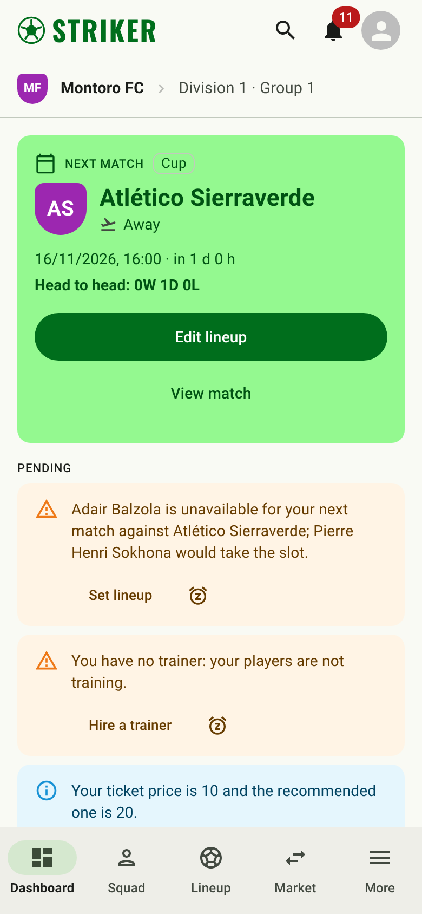
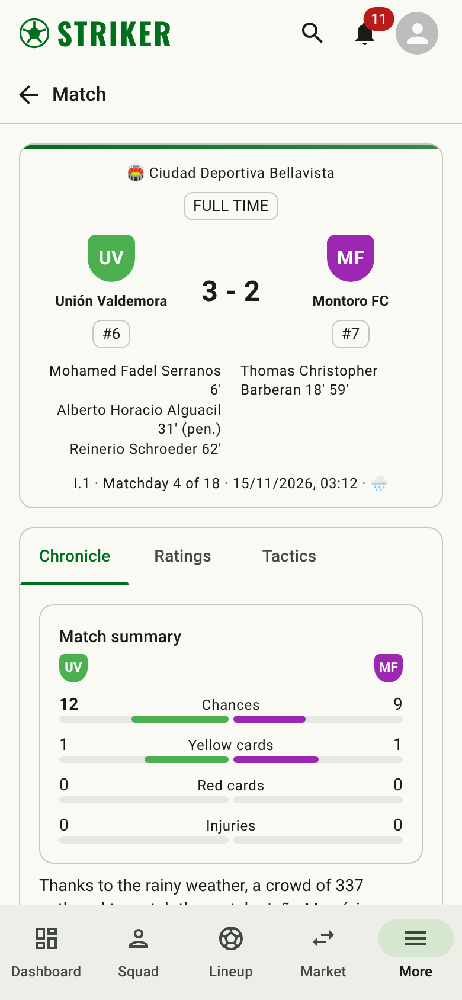
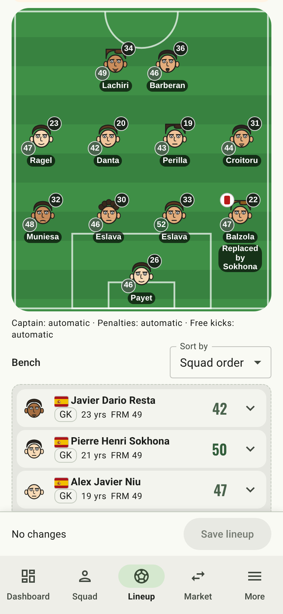
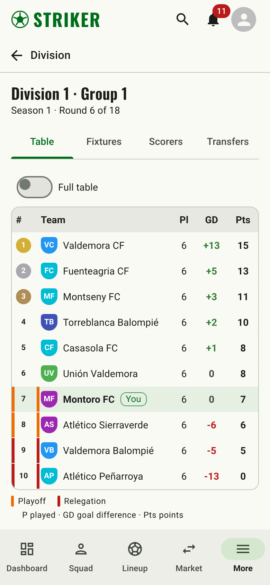
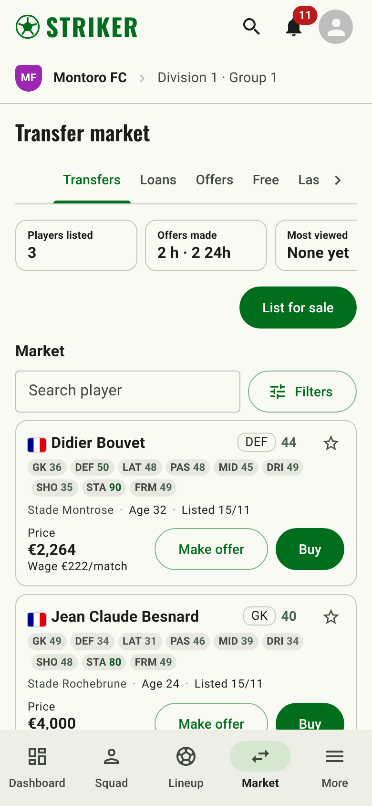
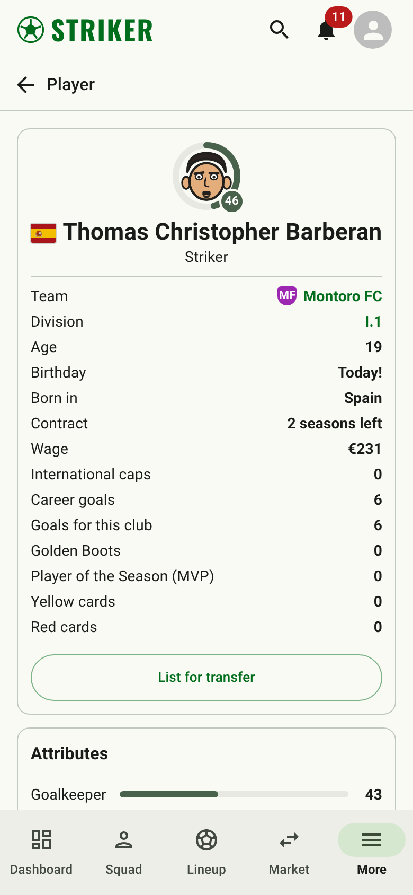

# Striker

**A browser-based football (soccer) management game.** Take charge of a club, pick the eleven,
haggle on the transfer market and watch your matches play out minute by minute — while every
other club in a living, multi-country world is run by CPU managers with their own personalities.

Striker is a persistent online world rather than a single-player save: matches kick off on a
real schedule, seasons roll over on their own, and the whole thing keeps moving whether you are
logged in or not. It runs in any browser and installs as an app on your phone.

<p align="center">
  
  &nbsp;
  
  &nbsp;
  
</p>
<p align="center">
  
  &nbsp;
  
  &nbsp;
  
</p>

## What you can do

**Run your club**
- Set your lineup on a tap-to-place pitch: formation, mentality, captain, set-piece
  takers and scheduled substitutions — with injured and suspended players kept out for you.
- Get a scouting preview of your next opponent and see where your lineup is projected to win or
  lose each duel.
- Hire a trainer, promote youngsters from your academy, renew (or let go of) expiring contracts.
- Balance the books: gate income, season-ticket holders (*socios*), sponsorship, prize money and
  merchandising against wages, stadium upgrades and transfer fees — all in a full ledger.

**Play the market**
- Buy, sell and loan players; make an offer, receive a counter-offer, or pay a release clause and
  sign him without his club's consent.
- Sign pre-contracts with players in the last year of their deal, pick up free agents, and keep a
  watchlist of targets that tells you when one becomes available.
- Price your offers with comparables: recent completed transfers of similar players.

**Compete**
- League pyramids with promotion, relegation and play-offs, plus a domestic cup alongside the
  league season.
- Regional club cups (European Cup, Copa America, Asian Cup, African Cup) for the best teams of
  each country.
- National teams drawn from each country's best players, friendlies between them, and a World Cup
  with a group stage and knockout rounds.
- End-of-season honours: Golden Boot and Player of the Season, and a trophy cabinet for every club.

**Watch it happen**
- Every match — league, cup or friendly — is simulated minute by minute, then revealed to viewers
  as if it were live: a running chronicle with commentary, live scores for the whole matchday,
  stoppage time, and a 1–10 rating for every player who featured.
- Rivalries grow out of shared history (close results, thrashings, cup eliminations), and a
  club's fanbase rises and falls with its results.
- Notifications for results, transfers, call-ups and awards — in the app and as push
  notifications.

**A world that lives without you**
- Every FIFA member association can be generated, with country-typical names, team names, stadiums
  and player avatars.
- CPU clubs pick their lineups, shop for players and manage contracts according to their AI level.
- Players age on their birthday, develop towards a hidden personal ceiling, and retire.

## Built with

- **Backend:** Go and Gin, PostgreSQL, Redis. One binary runs as the API (`--svc`), the background
  simulation engine (`--engine`, horizontally scalable) or the world seeder (`--initialize`).
- **Frontend:** React, TypeScript, Vite and Material UI (Material 3 design), installable as a PWA,
  in English and Spanish, with light and dark themes.
- **Observability:** OpenTelemetry metrics for HTTP traffic, matches simulated, season rollovers
  and more, with a ready-made Grafana dashboard in
  [`backend/resources/grafana/`](backend/resources/grafana/striker-dashboard.json) — see
  "OpenTelemetry metrics" in [`backend/README.md`](backend/README.md).
- **Sign-in:** Google OAuth, with a development login for local work.

## Quick start

You need Docker. One Compose file at the root runs everything - the API, the engine, the
frontend, Postgres and Redis - from the images published on every merge to `main`:

```bash
cp .env.sample .env            # set DEV_LOGIN_ENABLED=true to try it without Google OAuth
docker compose pull && docker compose up -d
docker compose run --rm init   # seed a world (wipes any existing game data)
```

The game is then at `http://localhost:3000` and the API at `http://localhost:1984`. Use
`docker compose up --build -d` instead to build the images from your checkout. Dev login is for
local use only.

[`HOWTO_RUN.md`](HOWTO_RUN.md) has the full set of options: environment variables, pinning and
upgrading image versions, using an existing Postgres/Redis, local development without Docker, and
a checklist for a public deployment.

## Documentation

- [`HOWTO_RUN.md`](HOWTO_RUN.md) — running, configuring and deploying Striker.
- [`ARCHITECTURE.md`](ARCHITECTURE.md) — how the codebase is put together.
- [`backend/README.md`](backend/README.md) — backend setup, database migrations, metrics, admin
  tooling.
- [`frontend/README.md`](frontend/README.md) — frontend setup and Docker build.
- [`openspec/specs/`](openspec/specs/) — how the game behaves, one capability per folder.

## How it's developed: OpenSpec

How the game behaves - match simulation, player development, the economy, CPU teams, national
teams and the World Cup - is specified in `openspec/specs/`, one folder per capability, each
ending with a code map of the files to open. New features go through
[OpenSpec](https://openspec.dev): `/opsx:explore` to think a change through, `/opsx:propose
<name>` to write its proposal, spec deltas and tasks under `openspec/changes/`, `/opsx:apply` to
implement it, and `/opsx:archive` to fold the deltas back into `openspec/specs/`. Install the CLI
with `npm install -g @fission-ai/openspec@1.14.3` (cloud sessions do it automatically through
`.claude/hooks/session-start.sh`) and check everything with `openspec validate --all --strict`.

## License

Striker is free software, released under the [GNU General Public License v3.0](LICENSE).
